# BẢN THIẾT KẾ HỆ THỐNG & TOÀN BỘ CÁC LUỒNG LOGIC (SYSTEM & LOGIC FLOWS BLUEPRINT)
**Dự án: VietDesk Office Suite**  
*Mục tiêu tài liệu: Mô tả 100% sơ đồ hệ thống, cấu trúc các khối và các luồng đi logic (Logic Flows) từ Cơ bản đến Cửa cuối mà không dùng code lập trình.*

---

## MỤC LỤC TỔNG THỂ
1. **Sơ đồ Phân rã Khối Chức năng Hệ thống (Functional Block Diagram)**
2. **Nhóm Luồng Tầng 1: Native Desktop & Vòng đời Dữ liệu Cục bộ (Basic)**
   * *Luồng 1.1: Khởi động, Đọc đĩa & Phục hồi sự cố (Crash Recovery)*
   * *Luồng 1.2: Đánh chặn Clipboard & Chuyển mã tự động (WASM Pipeline)*
   * *Luồng 1.3: Ghi đĩa nguyên tử (Atomic Local Save)*
3. **Nhóm Luồng Tầng 2: Hành chính NĐ30, OOXML & Bảng tính (Pro)**
   * *Luồng 2.1: Phân trang ảo và Dồn trang A4 thời gian thực (Virtual Pagination Logic)*
   * *Luồng 2.2: Chuyển đổi hai chiều OOXML (.docx/.xlsx Round-Trip)*
   * *Luồng 2.3: Ký số điện tử PKCS#11 & Niêm phong tài liệu NĐ30*
   * *Luồng 2.4: Bảng tính Kế toán, Đọc số tiền & Căn chỉnh vùng in ấn*
4. **Nhóm Luồng Tầng 3: Điện toán Đám mây, Cộng tác & Bảo mật (Ultimate)**
   * *Luồng 3.1: Đồng bộ thời gian thực CRDT & Xử lý đa điểm (Multi-user Sync)*
   * *Luồng 3.2: Rớt mạng ngoại tuyến & Đồng bộ bù (Offline Catch-Up)*
   * *Luồng 3.3: Lịch sử phiên bản & Time-Machine Rollback*
   * *Luồng 3.4: Bảo mật DLP, Watermark động & Phân quyền hạt nhân*
5. **Nhóm Luồng Tầng 4: Hệ điều hành Văn phòng Tự trị (Cửa Cuối - Agentic Loop)**
   * *Luồng 4.1: Tiếp nhận mục tiêu, Lập kế hoạch & Phân rã tác vụ (Goal Planning)*
   * *Luồng 4.2: Tương tác cây AST & Thẩm định thể thức NĐ30 tự động*
   * *Luồng 4.3: Đồng bộ dữ liệu chéo đa tài liệu (Word - Excel - Slide)*
   * *Luồng 4.4: Kiểm duyệt con người & Ban hành tự động (Human-in-the-Loop)*

---

# 1. SƠ ĐỒ PHÂN RÃ KHỐI CHỨC NĂNG HỆ THỐNG

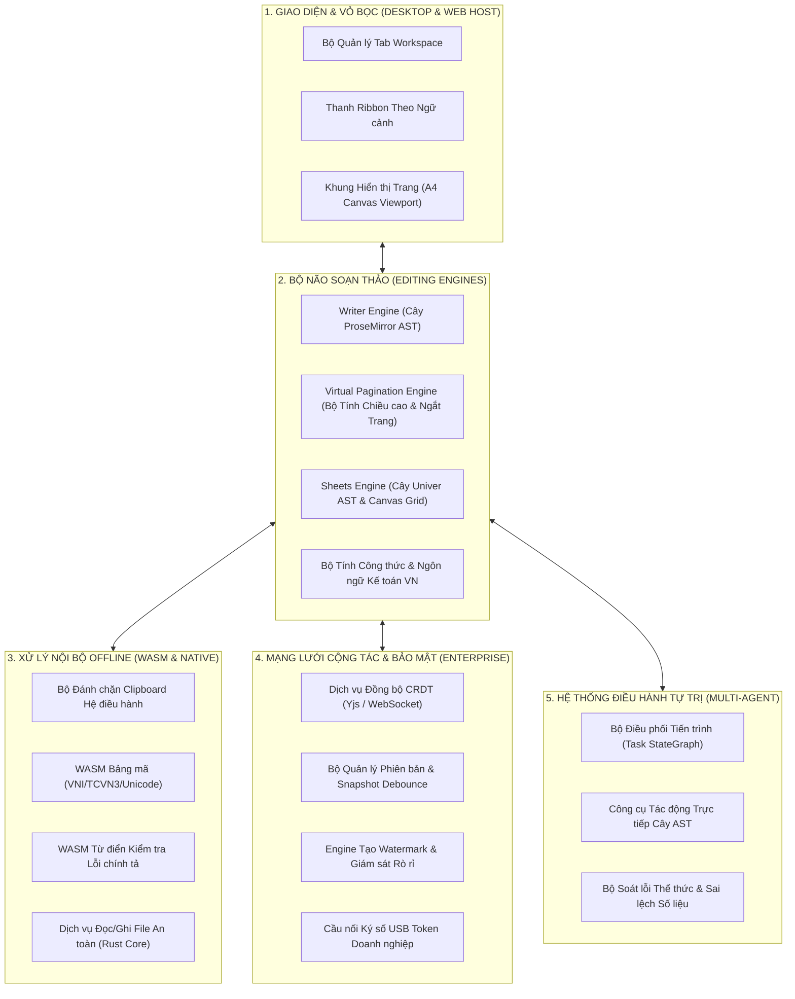

---

# 2. NHÓM LUỒNG TẦNG 1: NATIVE DESKTOP & VÒNG ĐỜI DỮ LIỆU CỤC BỘ

### Luồng 1.1: Khởi động Ứng dụng, Đọc đĩa & Phục hồi Sự cố (Crash Recovery)
*Mục đích: Đảm bảo ứng dụng bật lên ngay tức thì, tải file từ ổ cứng an toàn, và nếu có sự cố mất điện đột ngột thì khôi phục lại 100% trạng thái đang soạn thảo.*

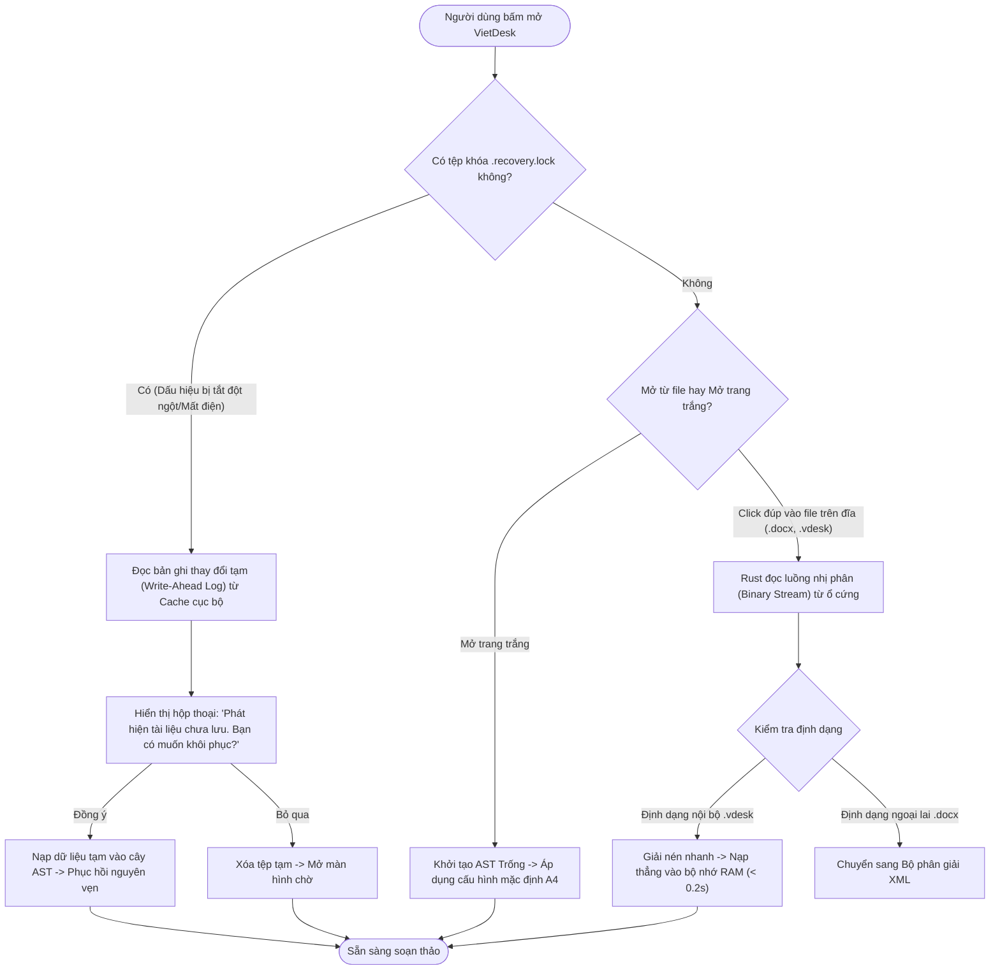

---

### Luồng 1.2: Đánh chặn Clipboard & Chuyển mã Tự động (WASM Pipeline)
*Mục đích: Người dùng dán văn bản từ các trang web cũ hoặc file cũ dùng font VNI/TCVN3, hệ thống tự động chuẩn hóa sang Unicode sạch sẽ mà không cần người dùng thao tác bằng tay qua Unikey.*

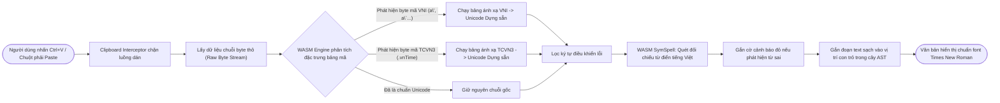

---

### Luồng 1.3: Ghi đĩa Nguyên tử (Atomic Local Save - Chống Hỏng File)
*Mục đích: Không bao giờ ghi đè trực tiếp lên file đang mở. Nếu đang ghi mà máy sập nguồn, file gốc vẫn nguyên vẹn.*

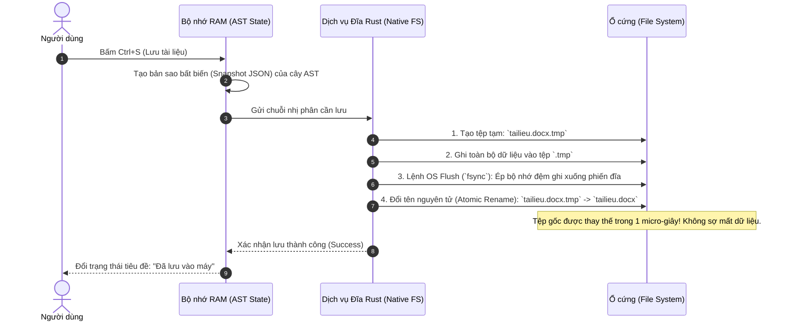

---

# 3. NHÓM LUỒNG TẦNG 2: HÀNH CHÍNH NĐ30, OOXML & BẢNG TÍNH

### Luồng 2.1: Phân trang Ảo và Dồn trang A4 Thời gian thực (Virtual Pagination Logic)
*Mục đích: Giải quyết điểm yếu nhất của các trình soạn thảo web. Mô phỏng chính xác từng trang giấy in ấn A4, tự động dồn trang, chống dòng mồ côi (Orphan/Widow Control) theo đúng chuẩn in ấn nhà nước.*

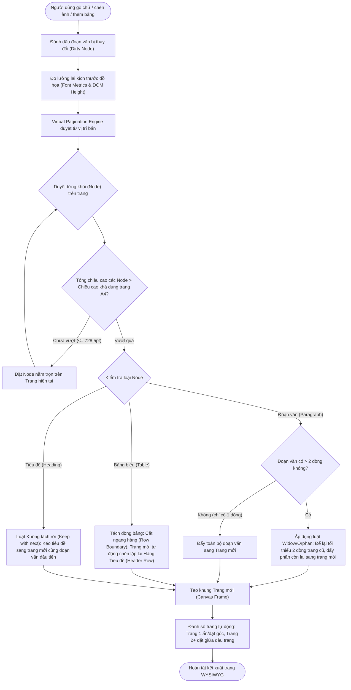

---

### Luồng 2.2: Chuyển đổi Hai chiều OOXML (Round-Trip `.docx` / `.xlsx`)
*Mục đích: Đọc và ghi file của Microsoft Office mà không làm mất định dạng hay vỡ layout.*

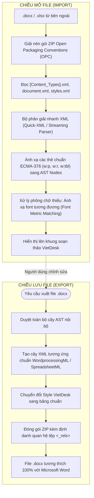

---

### Luồng 2.3: Ký số Điện tử PKCS#11 & Niêm phong Tài liệu NĐ30
*Mục đích: Tích hợp thiết bị phần cứng USB Token, ký số văn bản hành chính theo đúng chuẩn pháp lý nhà nước Việt Nam.*

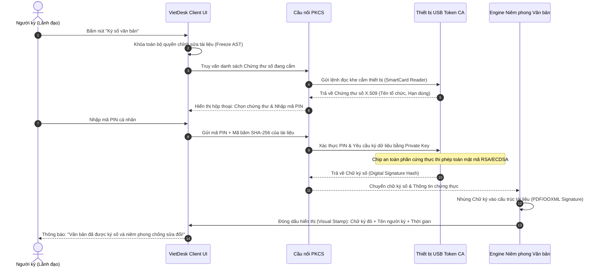

---

### Luồng 2.4: Bảng tính Kế toán, Đọc số tiền & Căn chỉnh Vùng in ấn
*Mục đích: Tự động hóa các nghiệp vụ kế toán đặc thù của Việt Nam (định dạng tiền tệ, viết chữ số tiền, ép trang in).*

```mermaid
flowchart TD
    subgraph CALCULATION ["1. XỬ LÝ NHẬP LIỆU & TÍNH TOÁN"]
        InputVal(["Nhập số vào ô A1: 15000000"]) --> FormatCell["Bấm định dạng tiền tệ Việt Nam (Format VND)"]
        FormatCell --> RenderVND["Hiển thị: 15.000.000 ₫ (Dùng dấu chấm phân cách nghìn)"]
        
        FormulaInput(["Nhập ô B1: =DOCSO(A1)"]) --> EvalEngine["Formula Engine chặn cú pháp hàm tùy biến"]
        EvalEngine --> CallWASMDocso["Truy xuất Module WASM DocsoVN"]
        CallWASMDocso --> ConvertAlgorithm["Thuật toán phân tích lớp: Tỷ, Triệu, Nghìn, Đồng + Xử lý 'mười' / 'mươi' / 'lăm' / 'nhất'"]
        ConvertAlgorithm --> ReturnText["Ô B1 hiển thị: 'Mười lăm triệu đồng chẵn'"]
    end

    subgraph PRINT_SETUP ["2. BỘ CĂN CHỈNH VÙNG IN (PRINT SETUP WIZARD)"]
        SelectArea(["Chọn dải bảng lương A1:M100 -> Bấm In"]) --> ScanMatrix["Quét kích thước tổng ma trận cột (Total Width in Pt)"]
        ScanMatrix --> CompareWidth{"Chiều rộng bảng > Khổ giấy A4 Ngang (297mm - Margin)?"}
        
        CompareWidth -- "Lớn hơn (Bị tràn trang)" --> AutoScale["Tự động kích hoạt thuật toán Fit-To-Page: Tính hệ số co dãn Scale Factor"]
        AutoScale --> ApplyScale["Co toàn bộ lưới bảng vừa vặn 100% trong chiều ngang 1 trang A4"]
        CompareWidth -- "Vừa vặn" --> KeepScale["Giữ tỉ lệ 100%"]

        ApplyScale --> PrintPreview["Hiển thị bản xem trước in ấn không bị xé cột"]
        KeepScale --> PrintPreview
    end
```

---

# 4. NHÓM LUỒNG TẦNG 3: ĐIỆN TOÁN ĐÁM MÂY, CỘNG TÁC & BẢO MẬT

### Luồng 3.1: Đồng bộ Thời gian thực CRDT & Xử lý Đa điểm (Multi-user Sync)
*Mục đích: Cho phép hàng chục người cùng mở một văn bản, gõ đồng thời mà không bị đè chữ, không có độ trễ, thấy con trỏ chuột của nhau theo thời gian thực.*

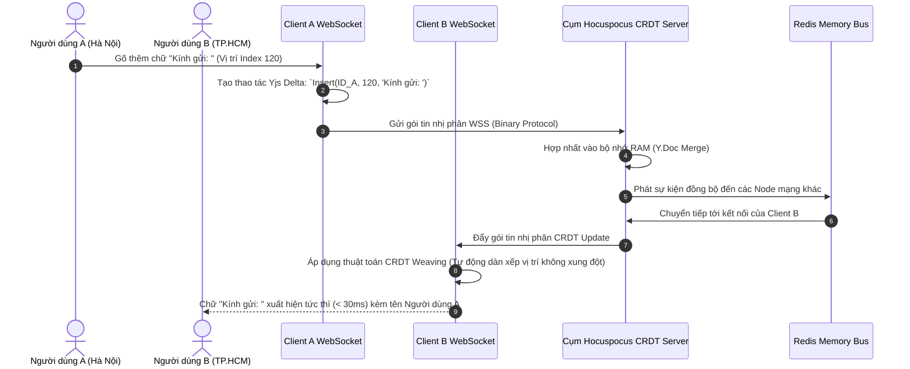

---

### Luồng 3.2: Rớt mạng Ngoại tuyến & Đồng bộ Bù (Offline Catch-Up)
*Mục đích: Đang làm việc thì mất mạng Wi-Fi, người dùng vẫn tiếp tục soạn thảo bình thường; khi có mạng lại, hệ thống tự động hòa giải và đồng bộ đầy đủ mà không mất chữ.*

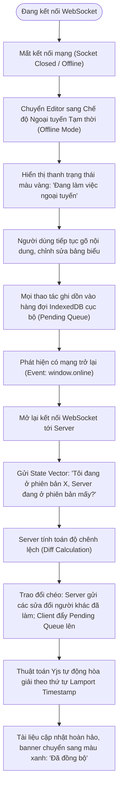

---

### Luồng 3.3: Lịch sử Phiên bản & Time-Machine Rollback
*Mục đích: Cho phép người dùng tua lại tài liệu về bất kỳ thời điểm nào trong quá khứ để xem ai đã sửa cái gì và khôi phục lại bản cũ nếu cần.*

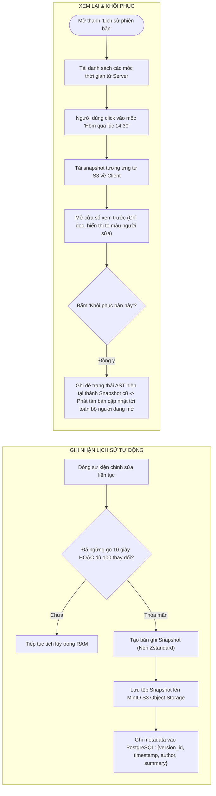

---

### Luồng 3.4: Bảo mật DLP, Watermark Động & Phân quyền Hạt nhân
*Mục đích: Chống chụp trộm màn hình làm lộ tài liệu mật, ngăn chặn sao chép dữ liệu ra ngoài và phân quyền chi tiết đến từng đoạn văn.*

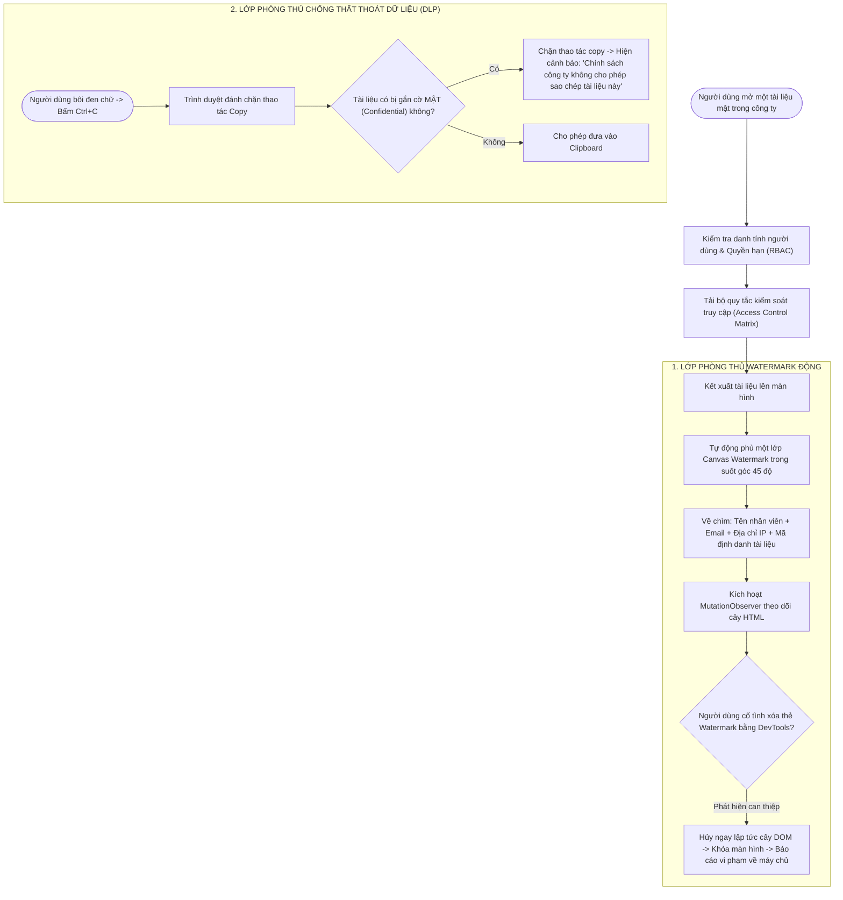

---

# 5. NHÓM LUỒNG TẦNG 4: HỆ ĐIỀU HÀNH VĂN PHÒNG TỰ TRỊ (CỬA CUỐI)

### Luồng 4.1: Tiếp nhận Mục tiêu, Lập kế hoạch & Phân rã Tác vụ (Goal Planning)
*Mục đích: Khi người dùng đưa ra một mệnh lệnh tự nhiên cấp cao, Agent tự động phân tích thành một đồ thị tác vụ thực thi tuần tự.*

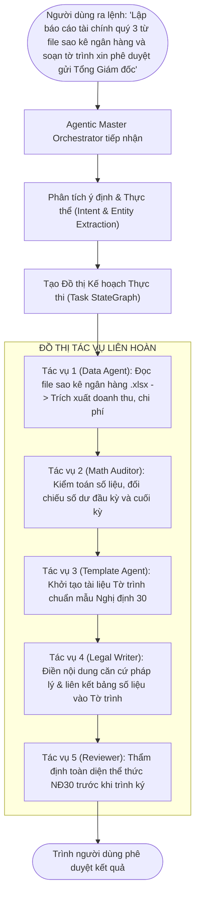

---

### Luồng 4.2: Tương tác Cây AST & Thẩm định Thể thức NĐ30 Tự động
*Mục đích: Agent không gõ chữ như con người mà sử dụng Tool Calling để can thiệp trực tiếp vào cấu trúc dữ liệu JSON AST của tài liệu.*

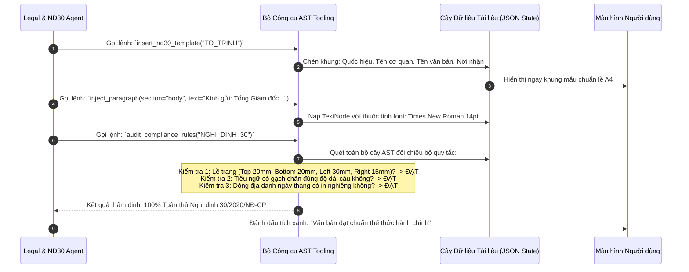

---

### Luồng 4.3: Đồng bộ Dữ liệu Chéo Đa Tài liệu (Cross-Document Single Source of Truth)
*Mục đích: Khi số liệu trong file Excel thay đổi, các bảng biểu trong file Word báo cáo và biểu đồ trong Slide thuyết trình tự động cập nhật theo thời gian thực mà không cần làm thủ công.*

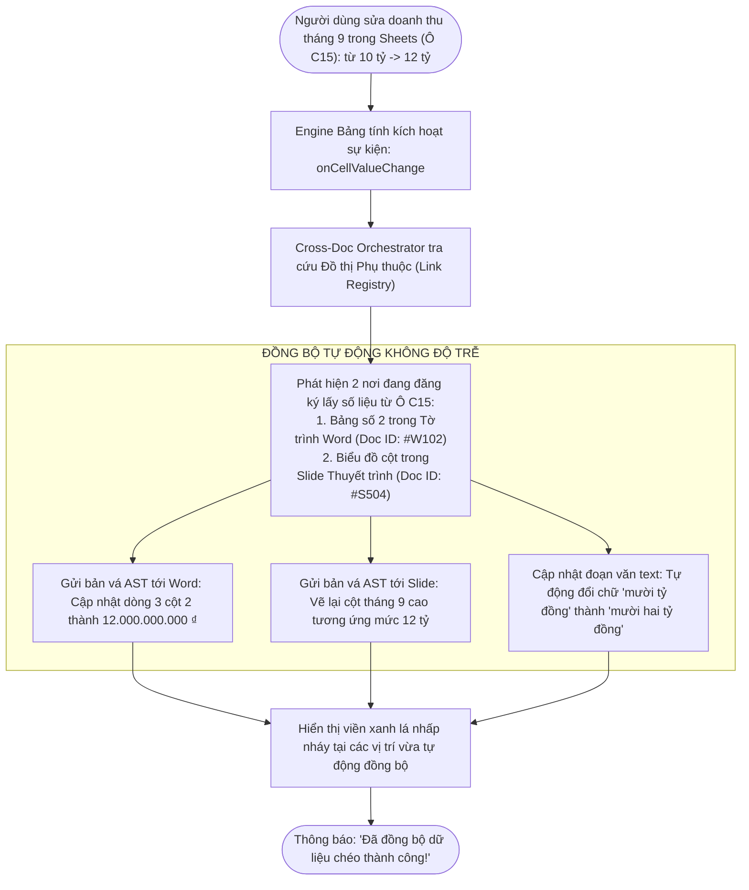

---

### Luồng 4.4: Kiểm duyệt Con người & Ban hành Tự động (Human-in-the-Loop)
*Mục đích: Đảm bảo nguyên tắc an toàn tối thượng: AI Agent có thể làm hết 99% công việc soạn thảo và tính toán, nhưng quyết định cuối cùng và tính pháp lý luôn thuộc về con người.*

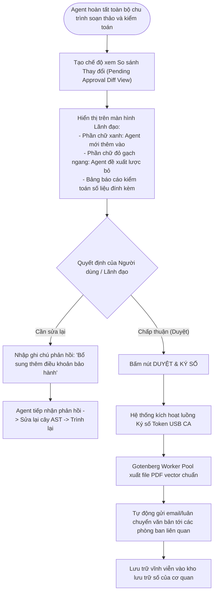

---

## 6. MA TRẬN TỔNG KẾT CÁC LUỒNG THEO 4 CẤP ĐỘ

| Cấp độ | Tên Luồng Logic | Đầu vào (Input) | Thành phần xử lý chính | Đầu ra (Output) |
| :--- | :--- | :--- | :--- | :--- |
| **Cơ bản** | **1.1. Khởi động & Crash Recovery** | Tệp đĩa / Tệp khóa phục hồi | Rust Tauri Backend, WAL Cache | Khôi phục 100% dữ liệu chưa lưu |
| | **1.2. Đánh chặn Clipboard** | Chuỗi byte từ clipboard hệ thống | WASM Charset & SymSpell Mapper | Text Unicode sạch, đúng font |
| | **1.3. Ghi đĩa nguyên tử** | Trạng thái AST tài liệu | Rust FS, lệnh atomic rename | File lưu an toàn chống sập nguồn |
| **Pro** | **2.1. Phân trang ảo A4** | Luồng Node thay đổi liên tục | Virtual Pagination Engine | Ngắt trang milimet chuẩn in ấn NĐ30 |
| | **2.2. Round-Trip OOXML** | File nhị phân `.docx` / `.xlsx` | Quick-XML Parser, OPC Zipper | Tương thích 2 chiều tuyệt đối với MS Office |
| | **2.3. Ký số Token PKCS#11** | Chứng thư số USB Token + PIN | Cầu nối PKCS#11, SHA-256 Engine | File niêm phong chữ ký số hợp pháp |
| | **2.4. Kế toán & Căn lề in ấn** | Số tiền thô + Ma trận ô | WASM Docso, Print Setup Wizard | Chữ tiền tệ tiếng Việt + Vừa khít trang in |
| **Ultimate** | **3.1. Đồng bộ CRDT Đa điểm** | Binary Delta qua WebSocket | Hocuspocus Cluster, Yjs Weaving | Trải nghiệm cộng tác độ trễ $< 30\text{ms}$ |
| | **3.2. Ngoại tuyến & Đồng bộ bù** | Trạng thái mất mạng internet | IndexedDB Queue, Lamport Vector | Hòa giải xung đột tự động khi có mạng lại |
| | **3.3. Lịch sử phiên bản** | Chuỗi thay đổi liên tục | MinIO S3, Zstandard Compressor | Time-Machine khôi phục bất kỳ thời điểm nào |
| | **3.4. DLP & Watermark động** | Phiên đăng nhập người dùng | WebGL Shader, MutationObserver | Chống chụp trộm màn hình & chống rò rỉ |
| **Cửa Cuối**| **4.1. Phân rã mục tiêu Agent** | Lệnh ngôn ngữ tự nhiên cấp cao | StateGraph Master Orchestrator | Đồ thị tác vụ thực thi tự động liên hoàn |
| | **4.2. Thao tác trên cây AST** | Yêu cầu nghiệp vụ hành chính | AST Tooling, Compliance Rules | Văn bản chuẩn thể thức NĐ30 tự động |
| | **4.3. Đồng bộ chéo tài liệu** | 1 ô thay đổi trong Sheets | Dependency Graph Link Registry | Word, Excel, Slide đồng bộ tự động 100% |
| | **4.4. Duyệt & Ban hành tự động** | Bản dự thảo kèm bảng kiểm toán | Human-in-the-Loop UI, Job Dispatcher | Ban hành văn bản chính thức chỉ với 1 cú click |

---
*Tài liệu này hoàn thiện 100% logic cấu trúc hệ thống và quy trình nghiệp vụ, đóng vai trò bản vẽ thiết kế kỹ thuật trước khi bước vào giai đoạn code.*
